<!-- 1. FIRST: Whoami (CRT Raster ASCII Portrait + High-Legibility Neofetch & Live Stats) -->

<h3><code>lastHunter956@github ~ $ whoami</code></h3>

<table>
<tr>
<td valign="top"></td>
<td valign="top"></td>
</tr>
</table>

 

<!-- 2. SECOND: Saviru/GitBanner-inspired 3-Act Animated Hero Banner -->

 
 

<!-- 3. THIRD: Contribution Snake Game (auto-updated daily by .github/workflows/snake.yml) -->

<h3><code>lastHunter956@github ~ $ ./play-snake.sh</code></h3>

 
 

<!-- 4. Telemetry Panels: Languages Radar + Activity Clock -->

<h3><code>lastHunter956@github ~ $ ./telemetry.sh --langs --clock</code></h3>

<table>
<tr>
<td valign="top"></td>
<td valign="top"></td>
</tr>
</table>

 
 

<!-- 5. Featured Projects (Large 2-Column Code-Window Cards) -->

<h3><code>lastHunter956@github ~ $ ls -la ./featured-projects</code></h3>

<table>
<tr>
<td valign="top"></td>
<td valign="top"></td>
</tr>
<tr>
<td valign="top"></td>
<td valign="top"></td>
</tr>
<tr>
<td valign="top"></td>
<td valign="top"></td>
</tr>
</table>

 
 

<!-- 6. Tech Stack (Large 48x48 Devicons) -->

<h3><code>lastHunter956@github ~ $ ls ./tech-stack</code></h3>

  &nbsp;&nbsp;
  &nbsp;&nbsp;
  &nbsp;&nbsp;
  &nbsp;&nbsp;
  &nbsp;&nbsp;
  &nbsp;&nbsp;
  &nbsp;&nbsp;
  
    
  &nbsp;&nbsp;
  &nbsp;&nbsp;
  &nbsp;&nbsp;
  &nbsp;&nbsp;
  &nbsp;&nbsp;
  &nbsp;&nbsp;
  

 

<!-- 7. Links -->

<h3><code>lastHunter956@github ~ $ ./links.sh</code></h3>

  &nbsp;&nbsp;
  

