<!-- Animated contribution heatmap: real GitHub data, refreshed daily by .github/workflows/update-profile.yml -->

<h3><code>lastHunter956@github ~ $ ./contributions.sh</code></h3>

 
 

<!-- Monochrome ASCII portrait (left) + neofetch developer & activity stats card (right).
     Both SVGs are 840x880 so equal display widths give equal heights. -->

<h3><code>lastHunter956@github ~ $ whoami</code></h3>

<table>
<tr>
<td valign="top"></td>
<td valign="top"></td>
</tr>
</table>

 
 

<h3><code>lastHunter956@github ~ $ ./links.sh</code></h3>

<b>Systems Engineer · Data Scientist · AI Developer</b> Transforming data into intelligent solutions from Cartagena, Colombia

 

